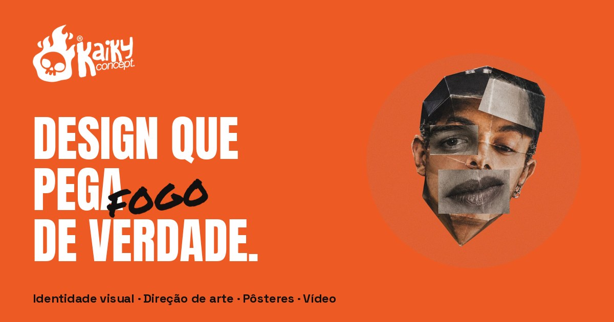

# Kaiky Concept. — Portfólio



**Site:** https://kaiky-concept.github.io/

Portfólio do **Kaiky Barreto**, designer gráfico, diretor de arte e videomaker de Ribeirão Pires, SP. Aqui estão os projetos do estúdio **Kaiky Concept.**: identidades visuais, direção de arte, a série autoral de pôsteres **CONCEPT FRAMES\*** e trabalhos em vídeo.

---

## Uma colaboração

O site nasceu de uma parceria entre o **Kaiky** e a **Giovana Campos**.

- **Giovana Campos** ([@ProjectCampos](https://github.com/ProjectCampos)) construiu a primeira versão do site: a estrutura, o código e a base visual que deram vida ao portfólio.
- **Kaiky Barreto** ([@kaiky-concept](https://github.com/kaiky-concept)) cuidou do conteúdo, da identidade visual, da direção de arte e da evolução do site para esta versão mais interativa.

A primeira versão continua no GitHub da Giovana, em [projectcampos/kaiky-concept](https://github.com/projectcampos/kaiky-concept). Este repositório é a continuação dela.

## O que tem no site

| Seção | O que mostra |
|---|---|
| **Início** | Apresentação com uma pilha de cases que troca sozinha e leva ao projeto no Behance |
| **Manifesto** | Como o Kaiky trabalha: estratégia, sistema e uma mesma linguagem do logo ao vídeo |
| **Trabalhos** | 8 identidades visuais: Master Churrascaria, akta®, nutrisolo®, KAOS®, oros., Alexandre Álvaro, Fluxo Ubuntu e MBA Soluções Financeiras |
| **Pôsteres** | A série CONCEPT FRAMES\* ('Archives' e Texxxxxturing), com visualizador em tela cheia e lupa para ler os detalhes |
| **Vídeo** | *Ponto a Ponto*, entrevista documental com Eder Miranda, com capítulos clicáveis (direção, captação, edição e finalização) |
| **Serviços** | Identidade visual, direção de arte, pôsteres e tipografia, vídeo e motion, papelaria e social |
| **Sobre** | Quem é o Kaiky, com a colagem de autorretrato |
| **Contato** | E-mail (copia com um clique), Instagram e Behance |

## Interações

- Tela de carregamento em que o foguinho do logo pega fogo de baixo pra cima (pode ser pulada e nunca passa de 3,5 s)
- Vinheta animada no "Sobre" (abre com som) e prévia em vídeo no hover de "Vídeo & motion"
- Foguinho no rodapé que enche conforme a página rola e leva de volta ao topo
- Título com "FOGO" pintado à mão por cima
- Bolha de vidro que aparece sobre itens clicáveis, mantendo o cursor padrão do sistema
- Cases com inclinação 3D e brilho que segue o mouse
- Manifesto que acende palavra por palavra com o scroll
- Pôsteres em trilho arrastável, com efeito de separação de cores no hover
- Player leve do YouTube: o vídeo só carrega quando a pessoa clica
- Respeita a opção de "reduzir movimento" do sistema e funciona no celular

## Estrutura

```
index.html              página única (HTML, CSS e JavaScript juntos, sem dependências)
img/                    capas dos cases, logo, foto, favicon e imagem de compartilhamento
img/posters/            pôsteres da série CONCEPT FRAMES*
img/video/              capa e cenas do documentário Ponto a Ponto
video/                  vinheta Kaiky Concept. (mp4, webm, loop e capa)
.nojekyll               avisa o GitHub Pages para servir os arquivos como estão
```

Não precisa instalar nada nem rodar build. Para ver localmente, basta abrir o `index.html` no navegador ou rodar um servidor simples na pasta:

```bash
python3 -m http.server 8000
# depois abrir http://localhost:8000
```

## Publicação

O site é publicado pelo **GitHub Pages** a partir da branch `main`. Qualquer alteração enviada para a `main` entra no ar em poucos minutos.

## Créditos

- **Design, conteúdo e direção de arte:** Kaiky Barreto · [@kaiky-concept](https://github.com/kaiky-concept)
- **Desenvolvimento da primeira versão:** Giovana Campos · [@ProjectCampos](https://github.com/ProjectCampos)
- **Fontes:** Anton, Permanent Marker, Space Grotesk, Space Mono e Bodoni Moda, via Google Fonts

## Contato

- E-mail: kaikyorib@gmail.com
- Instagram: [@kaikyconcept](https://www.instagram.com/kaikyconcept/)
- Behance: [behance.net/kaikyconcept](https://www.behance.net/kaikyconcept)

Todos os trabalhos, imagens e pôsteres deste repositório são de autoria do Kaiky Barreto / Kaiky Concept. e não podem ser reutilizados sem autorização.
